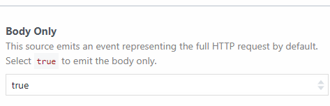

# Retrieve SMS history from Pipedream

This npm library enhances Cypress testing capabilities by providing convenient commands for retrieving received SMS history from Pipedream.  
Simplify your end-to-end testing workflow by effortlessly integrating SMS history verification into your Cypress tests.

<h3 align="center">
  <a href="https://www.npmjs.com/package/cypress-pipedream-plugin">
    
  </a>
  <a href="https://www.npmjs.com/package/cypress-pipedream-plugin">
    
  </a>
  <a href="https://paypal.me/AlecMestroni?country.x=IT&locale.x=it_IT">
      
  </a>
</h3>

## Install

```shell
$ npm install cypress-pipedream-plugin --save-dev
```

Alternatively, you can install it as a global module:

```shell
$ npm install -g cypress-pipedream-plugin
```

## Cypress compatibility

The plugin works with every Cypress version, including Cypress 16.

`Cypress.env()` is deprecated since Cypress 15.10.0 and has been removed in Cypress 16: from version 1.4.0 the plugin reads its configuration with the `cy.env()` command when it is available (Cypress 15.10.0 or later) and falls back to `Cypress.env()` on older versions. Nothing changes in your configuration.

| `cypress-pipedream-plugin` | Cypress                             |
| -------------------------- | ----------------------------------- |
| >= 1.4.0                   | Every version, including 16         |
| <= 1.3.0                   | Up to 15.x (not compatible with 16) |

## Prerequisites

A Pipedream source: https://pipedream.com/sources/new.  
Pay attention to set the _Body Only_ option to true when creating the source, if you haven't and you have already created the Pipedream-Source enables it here: https://pipedream.com/sources/{your-source}/configuration



## Added commands

| Commands                            | Notes                                                                                                                                                    |
| ----------------------------------- | -------------------------------------------------------------------------------------------------------------------------------------------------------- |
| cy.getNewestMessage(deleteAfter)    | Retrieves the last (NEWEST) SMS for a specific Pipedream Source History within a specified time limit. Optional: set `deleteAfter=true` to auto-delete.  |
| cy.getOldestMessage(deleteAfter)    | Retrieves the first (OLDEST) SMS for a specific Pipedream Source History within a specified time limit. Optional: set `deleteAfter=true` to auto-delete. |
| cy.getArrayMessage()                | Retrieves all SMS messages as an array of objects with `{id, message}` structure. Returns full message list with IDs for selective deletion.             |
| cy.deleteSpecificMessage(messageId) | Deletes a specific message by its ID. Use after `getArrayMessage()` to selectively remove individual messages.                                           |
| cy.clearMessagesHistory()           | Clears the entire SMS history for a specific Pipedream Source.                                                                                           |
| cy.clearHistorySendSmsAndGetSMS()   | This command simplifies the usage by executing the following commands in sequence:                                                                       |

```javascript
cy.clearMessagesHistory() //
cy.get('[data-cy="send-sms"]', { timeout: 120000 }).click() // Command to send the SMS from the frontend
cy.getNewestMessage()
```

According to [cypress documentation](https://docs.cypress.io/guides/references/best-practices#Selecting-Elements) adding the data-cy tag to your frontend, is the best way to keep your test updated and maintainable.

## Configuration

### Inside `cypress/support/e2e.js`

At the top of your support file (usually cypress/support/e2e.js for e2e testing type):

```javascript
import "cypress-pipedream-plugin"
```

### Inside your environment file

You MUST set these environment variables to make this plugin working

| Parameter           | Mandatory | Notes                                                                                  | Default                         |
| ------------------- | --------- | -------------------------------------------------------------------------------------- | ------------------------------- |
| pipedreamBearer     | TRUE      | Bearer used for Pipedream Auth                                                         | \                               |
| pipedreamSourceID   | TRUE      | Your Pipedream Source ID                                                               | \                               |
| pipedreamMaxRetries | Optional  | Maximum wait time (in minutes) for `cy.getOldestMessage()` and `cy.getNewestMessage()` | 1                               |
| pipedreamFolderPath | FALSE     | Folder where the SMS body will be saved                                                | 'cypress/fixtures/sms_response' |
| pipedreamFileName   | FALSE     | File name in which the message will be written                                         | 'message.json'                  |

Set them in the `env` object of your Cypress configuration (or with `--env`, `cypress.env.json`, `CYPRESS_*` variables):

```javascript
// cypress.config.js
module.exports = defineConfig({
  env: {
    pipedreamBearer: "Bearer XXXXXX",
    pipedreamSourceID: "dc_XXXXXX",
  },
})
```

`pipedreamBearer` is a secret: keep it in `env`, where it is read with `cy.env()` and stays out of the browser until a command needs it.
On Cypress 15.10.0 or later the other, non-sensitive, parameters can also be set in the `expose` object of the Cypress configuration: a value in `env` takes precedence over the same key in `expose`.

To set these variables dynamically in a multi environment cypress-test, you can use the following plugin:
[cypress-env](https://www.npmjs.com/package/cypress-env)

### Considerations

#### Auto-delete messages after retrieval

You can automatically delete a message after reading it by passing `true` to the `deleteAfter` parameter:

```javascript
// Get newest message and delete it automatically
cy.getNewestMessage(true)

// Get oldest message and delete it automatically
cy.getOldestMessage(true)
```

#### Working with message arrays and selective deletion

Use `getArrayMessage()` to retrieve all messages with their IDs, then selectively delete specific ones:

```javascript
// Get all messages with IDs
cy.getArrayMessage()

// Read the saved array and delete a specific message
cy.readFile("cypress/fixtures/sms_response/message.json").then((messages) => {
  // messages = [{ id: "1762787731250-0", message: "Your SMS text here" }, ...]

  // Delete the first message
  cy.deleteSpecificMessage(messages[0].id)

  // Or delete a message based on content
  const messageToDelete = messages.find((msg) => msg.message.includes("verification code"))
  if (messageToDelete) {
    cy.deleteSpecificMessage(messageToDelete.id)
  }
})
```

#### Reading message contents

To check the file contents, you can use the following command:

```javascript
cy.readFile('cypress/fixtures/sms_response/message.json', {
	timeout: 60000,
	retries: 3,
}).then((message) {
  ... // do something with the saved message
})
```

### Missing configuration error:

From version 1.4.0 the configuration is checked when a command of the plugin is used (and no longer when the plugin is imported), so only the tests that use the plugin fail:

```
────────────────────────────────────────────────────────────────────────────────────────────────────

  Running:  myFirstTest.cy.js                                                               (1 of 1)

  1) should receive the SMS

  0 passing (1s)
  1 failing

  1) should receive the SMS:
     Error: CYPRESS-PIPEDREAM-PLUGIN | Missing environment variables: env('pipedreamBearer') & env('pipedreamSourceID') needed

────────────────────────────────────────────────────────────────────────────────────────────────────
```

## THE JOB IS DONE!

Happy testing to everyone!

ALEC-JS

<h3 align="center">
🙌 Donate to support my work & further development! 🙌
</h3>

<h3 align="center">
  <a href="https://paypal.me/AlecMestroni?country.x=IT&locale.x=it_IT">
    
  </a>
</h3>
